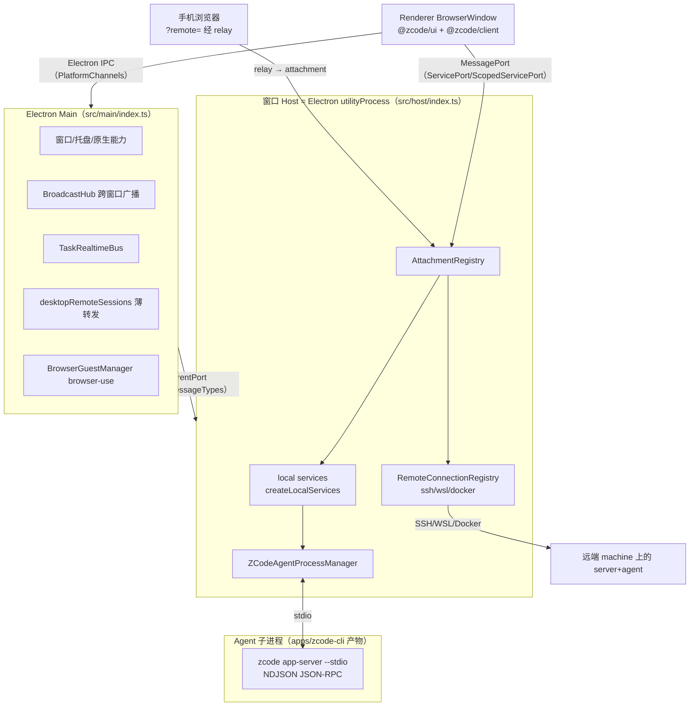
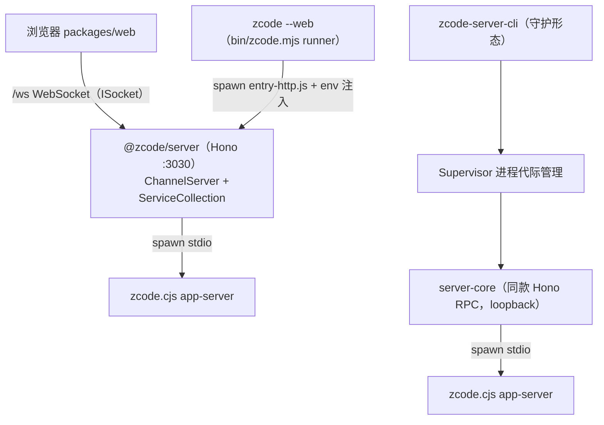
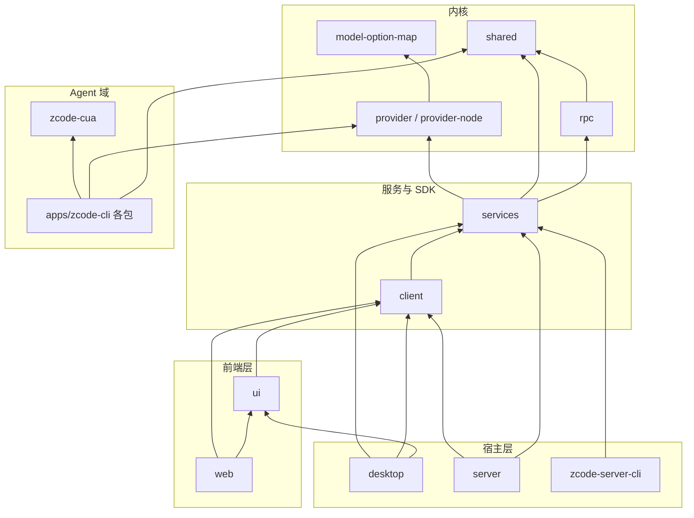
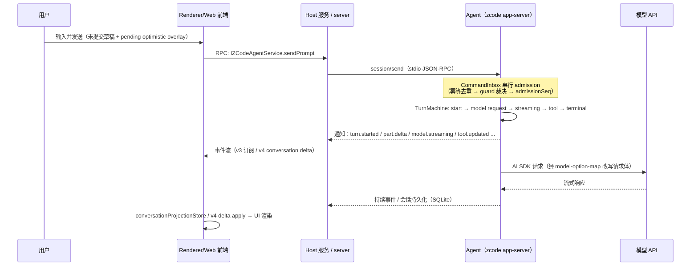

# 02 · 整体架构

## 1. 进程拓扑

ZCode 的核心结构是「**一个 Agent 进程 + 一个宿主进程 + 一个前端**」。三种产品形态共享同一套 RPC 与协议，仅宿主不同。

### 1.1 桌面形态（packages/desktop）

要点：

- **一个窗口一个 Host**（window-scoped）；窗口内多个本地 workspace 共享该 Host。Renderer reload 不断 Host——Main 会向存活 Host 补挂新 MessagePort（`packages/desktop/src/main/desktopWindowLifecycle.ts`）。
- **Main 不承载业务状态**：只做窗口、原生操作、进程调度、消息转发与广播。任务/会话状态在 Agent（事实源）与 Host 服务投影中。
- **手机远控复用桌面已有 Host attachment**，不另起 Agent 或 Local Host（AGENTS.md 边界规则）。

### 1.2 Web / CLI 发行形态

- Web 前端与桌面 Renderer 是**平行的宿主装配层**：都复用 `@zcode/ui` 的 `Root` 与 `@zcode/client` 的连接函数，只是传输不同（WebSocket vs MessagePort）。
- `zcode --web` 与 `zcode`（TUI/Agent CLI）由发行包 `bin/zcode.mjs`（源 `scripts/zcode-distribution/runner.mjs`）分流。
- `zcode-server-cli` 是同一服务内核的守护化发行：Supervisor 管理 Core 子进程代际、崩溃退避（CrashBudget）、release 下载/回滚、OS 服务注册，不经 `@zcode/server` 而自带 server-core。

### 1.3 TUI 形态（无进程边界）

TUI **不经协议**：`packages/cli` 直接在进程内调 `@zcode/bootstrap` 的 `createZCodeApp`（`apps/zcode-cli/packages/cli/src/tui-prompt-handler.ts`）。headless `-p` 同理走进程内 `runPrompt`。

## 2. 包依赖分层

依赖方向纪律（由 `pnpm architecture:check` 依据 `architecture-policy.yaml` 强制）：

- `shared` 是协议与领域类型的**单一事实源**，被 Agent 侧与宿主侧同时引用——两侧对协议的改动在同一个包内收敛。
- `rpc` 与业务无关；具体传输包装（WebSocket/stdio/MessagePort）放在消费方（`packages/client`、`packages/server`、`packages/desktop/src/host/electronPort.ts`）。
- UI 不直接依赖 `services` 的实现，经 `@zcode/client` 的 `IServiceAccessor`；平台操作只经 `IPlatformService`（`packages/shared/src/platform.ts`）。
- Agent 域（`apps/zcode-cli/*`）不反向依赖宿主包；宿主通过 spawn + 协议消费 Agent。
- `forbidCycles: true`、`forbidDeepImports: true`、`managedOnly`（存量模块逐步迁移，见策略文件注释）。

## 3. 核心数据链路：一次用户输入的生命周期

以桌面/Web 形态发送一条消息为例（时序）：

关键点：

- **输入 admission 在 CLI/runtime 侧**：已接受的 busy/running 输入由 `CommandInbox` 串行裁决（`apps/zcode-cli/packages/bootstrap/src/zcode-protocol-v4/command-inbox.ts`）；Renderer 只保留未提交草稿与 pending optimistic overlay，不做事实判断。
- **流式回显两条路**：v3 `session/subscribe` 事件族与 v4 `v4/conversation/subscribe` delta 流并存，v4 是收敛方向（`packages/shared/src/zcode-protocol-v4/`）。
- **会话事实在 Agent 进程**：SQLite 存储由 `@zcode/adapters/storage` 承担；宿主侧服务只做投影、索引同步与事件聚合（`packages/services/src/zcode-agent/` 下 27 个文件）。

## 4. 关键架构决策（为什么这样设计）

| 决策                               | 内容                                                                      | 动机 / 收益                                                |
| ---------------------------------- | ------------------------------------------------------------------------- | ---------------------------------------------------------- |
| window-scoped Host                 | 每窗口一个 utilityProcess Host；本地 workspace 共享；远程由连接注册表管理 | 隔离窗口故障域；reload 不丢会话；避免全局单点              |
| Main 无业务状态                    | Main 只做调度/转发/原生能力                                               | 跨平台差异（托盘、更新、深链）收敛在 Main，业务逻辑可测    |
| 协议在 shared 单源                 | zod schema（strict + 限长 + discriminatedUnion）同时约束两侧              | 防无界载荷；协议改动有运行时校验兜底                       |
| ProxyChannel 自动服务化            | `ServiceDescriptor + ServiceCollection + exposeOnChannelServer`           | 新增服务只写一个 class + descriptor，自动获得 RPC 能力     |
| Agent 子进程而非进程内（宿主形态） | spawn `app-server --stdio`                                                | Agent 崩溃不拖垮宿主；同一 Agent 服务桌面/Web/远端三种宿主 |
| TUI 进程内直连                     | 不经协议帧                                                                | 终端启动延迟与复杂度；协议路径留给跨进程场景               |
| 双 clientMode                      | `desktop-continuous` / `web-remote-replayable`，投递档位 30ms/150ms       | 桌面要低延迟流镜像，手机要断线可回放恢复                   |
| workspaceIdentity ≠ workspacePath  | `remote:ssh:...` 等身份键统一路由                                         | 远程场景下路径不唯一；去重/绑定/缓存有稳定键               |
| v3/v4 协议显式并存                 | v4 网关叠加在旧方法面上，v3 方法标注 @deprecated                          | 渐进迁移，不断旧客户端                                     |
| fail-closed 占位包                 | zcode-cua 契约保留、实现摘除                                              | 开源构建类型兼容，闭源能力按需接入                         |
| pnpm patches                       | `@ai-sdk/*`、`@arms/rum-electron` 补丁                                    | 上游修复未发布前的最小侵入修正                             |

## 5. 从需求到代码：常见改动落点

| 需求类型            | 落点                                                                                                                                                                                                      |
| ------------------- | --------------------------------------------------------------------------------------------------------------------------------------------------------------------------------------------------------- |
| 协议新增方法/事件   | `packages/shared/src/zcode-protocol/index.ts`（v3）或 `zcode-protocol-v4/`；Agent 侧 handler 在 `apps/zcode-cli/packages/bootstrap/src/zcode-protocol*/`；宿主投影在 `packages/services/src/zcode-agent/` |
| 新增业务服务        | `packages/services/src/<域>/` 新模块（descriptor + 实现），注册进宿主 `createLocalServices`；前端在 `packages/ui/src/hooks/` 加 hook                                                                      |
| UI 组件/交互        | `packages/ui/src/`（遵守 DESIGN.md）；桌面专属桥接在 `packages/desktop/src/preload/` + `Main` 对应 handler                                                                                                |
| Agent 工具/权限规则 | `apps/zcode-cli/packages/core/src/tool/`、`permission/`                                                                                                                                                   |
| 模型 Provider 适配  | `packages/provider(-node)` 配置 + `apps/zcode-cli/packages/adapters/src/model/model-execution.ts`                                                                                                         |
| 远程连接能力        | `packages/server/src/remote/` backend + `packages/desktop/src/host/windowRemoteConnectionRegistry.ts`                                                                                                     |

> 改动前先看 [13-development-guide.md](13-development-guide.md) 的架构治理流程——先更新 spec、再跑 `pnpm architecture:check --changed`。
