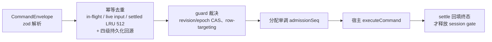

# 03 · 通信与协议

ZCode 有四类通信边界，全部有明确的 schema 与单一事实源：

1. **RPC 通道**（`@zcode/rpc`）：前端 ↔ 宿主服务之间，传输无关。
2. **Agent 协议**（zcode-protocol，v3 与 v4 wire 并存）：宿主 ↔ Agent 子进程，stdio NDJSON。
3. **Host 消息**（`HostMessageTypes` / `HostResponseTypes`）：Electron Main ↔ Host utilityProcess。
4. **Electron IPC / preload 桥**（`PlatformChannels` / `InternalChannels`）：Renderer ↔ Main。

## 1. RPC 框架（packages/rpc）

`@zcode/rpc` 自述为 "VS Code style IPC communication framework"，零业务依赖、源码直发。分层（文件均在 `packages/rpc/src/`，`index.ts` 顶部有权威 ASCII 图）：

| 层             | 关键文件                                                                          | 内容                                                                                                                                                                                                                                                                                                                                                                                                       |
| -------------- | --------------------------------------------------------------------------------- | ---------------------------------------------------------------------------------------------------------------------------------------------------------------------------------------------------------------------------------------------------------------------------------------------------------------------------------------------------------------------------------------------------------- |
| L0 基础设施    | `foundation.ts`、`buffer.ts`                                                      | `Event/Emitter/Relay`、`IDisposable/DisposableStore`、`CancellationToken`、`VSBuffer`                                                                                                                                                                                                                                                                                                                      |
| L1 序列化      | `serialization.ts`                                                                | `[1B 类型标签][VQL 长度][数据]`；嵌套 `Uint8Array` 在 JSON fallback 中以 base64 标记往返保留                                                                                                                                                                                                                                                                                                               |
| L2 传输抽象    | `protocol.ts`、`persistent-protocol.ts`                                           | **`IMessagePassingProtocol`（腰部抽象，上层传输无关）**；`ISocket`（onData/write/drain）统一 TCP/WebSocket/stdio；`SocketProtocol` 13 字节帧头（type/id/ack/length）+ KeepAlive/ReplayRequest；`MessagePortProtocol`（Electron/Worker，天然消息边界 + `connection-flow-v1` 流控帧）；`PersistentProtocol` 叠加 ACK、心跳、有界断线重放（`replayBufferMaxBytes/GraceMs`）、拥塞水位 `onSaturated/onDrained` |
| L3 Channel RPC | `channels.shared.ts`、`channelServer.ts`、`channelClient.ts`、`delayedChannel.ts` | `IChannel.call(command, arg, ct) / listen(event, arg)`；`ChannelServer`（channel 注册前请求先挂起）；`getDelayedChannel` 把 Promise 化 channel 变同步代理                                                                                                                                                                                                                                                  |
| L4 连接管理    | `ipc.ts`                                                                          | `IPCServer`（1:N，可经 `IClientRouter` 反向调用客户端）、`IPCClient`（1:1 双向）；客户端首条消息 = 身份 ctx                                                                                                                                                                                                                                                                                                |
| L5 服务代理    | `proxy-channel.ts`                                                                | `ProxyChannel.fromService/toService`：方法 → call、`onXxx` → listen（事件 buffer 化防丢），ES6 Proxy 还原类型安全对象                                                                                                                                                                                                                                                                                      |
| 横切中间件     | `logging-middleware.ts`、`network-telemetry-middleware.ts`                        | 装饰器：调用耗时日志、网络遥测观察                                                                                                                                                                                                                                                                                                                                                                         |
| L6 远程        | `remote.ts`                                                                       | `RemoteAuthorityResolverService`（"ssh+host" → `ResolvedAuthority`）、`RemoteSocketFactoryService`（策略选 `ISocketFactory`）、`RemoteAgentConnection`（退避重连 `RECONNECT_DELAYS`）、`createURITransformer`（vscode-remote ↔ file 路径）                                                                                                                                                                 |

**具体传输的包装位置**（rpc 只定义 `ISocket`）：

| 传输                 | 包装处                                                                                                |
| -------------------- | ----------------------------------------------------------------------------------------------------- |
| 浏览器 WebSocket     | `packages/client/src/websocket.ts` `wrapBrowserWebSocket`                                             |
| 服务端 WebSocket     | `packages/server/src/http.ts` `wrapWebSocket`                                                         |
| Node stdio           | `packages/server/src/stdio.ts` `wrapStdio`（stdout 专属 RPC，日志走 stderr）                          |
| SSH 子进程 stdio     | `packages/server/src/remote/stdio-socket.ts` `wrapStdioStream`                                        |
| Electron MessagePort | `packages/client/src/messageport.ts` + `packages/desktop/src/host/electronPort.ts` `wrapElectronPort` |

## 2. Agent 协议（zcode-protocol）

### 2.1 v3：方法面 + 事件流（`packages/shared/src/zcode-protocol/index.ts`，约 3700 行）

- **消息模型**：JSON-RPC 风格四态（无 `jsonrpc` 字段）：`Request {id, method, params, trace?}` / `Response {id, result}` / `Error {id, error:{code,message,data}}` / `Notification {method, params}`。trace 透传 `traceparent/traceId`。
- **方法表** `zcodeProtocolMethods`（约 60 个）：`session/create`、`session/send`、`session/subscribe`、`workspace/*`、`provider/*`、`mcp/list`、`plugins/*`、`automation/*`、`offPeak/*`、`interaction/*`（反向请求族）等；其中多个标注 `@deprecated` 指向 v4 收敛。
- **事件类型** `zcodeSessionEventTypeSchema`：会话生命周期（created/resumed/updated/closed）、turn（started/steerQueued/steerDrained/completed/failed）、消息与 part（upserted/delta/removed）、`model.streaming`（start/finish/error、text/reasoning/tool 系列）、`tool.updated`、`permission.requested/resolved`、`userInput.requested/resolved`、`checkpoint.created`、`rewind.triggered`、`streamRecovery.updated`。事件信封 `zcodeEventEnvelopeSchema` 带 `eventId/sessionId/turnId/seq/deliveryKind`。
- **会话快照** `zcodeSessionStateSnapshotSchema`：protocol/session/settings/projection/runtime/messages/todos/slashCommands。
- **校验纪律**：全部 `z.object().strict()` + `z.discriminatedUnion` + 限长（协议边界防无界载荷是明确设计目标）。
- **Agent 侧实现**：协议服务器 `apps/zcode-cli/packages/bootstrap/src/zcode-protocol/server.ts`（`ZCodeProtocolAgentServer`，`handleMessage` 分发）；传输 `transport.ts`（`ZCodeProtocolNdjsonConnection`，逐行解析、post-response 批量写出）；会话操作 `server-operations.ts`（`createSession`/`sendPrompt` 等）。
- **宿主侧消费**：`packages/services/src/zcode-agent/zcodeStdioTransport.ts` + `zcodeProtocolClient.ts`（入站 zod 校验）、`zcodeSessionEventCoalescer.ts` 事件聚合。

### 2.2 v4：wire 协议与命令 admission（`packages/shared/src/zcode-protocol-v4/`，约 50 文件）

包纪律：**只放 schema + 纯函数，运行时不进包**。

- `core.ts`：`V4_WIRE_PROTOCOL_VERSION = 3`；`DeliveryProfile` 两档投递（continuous 30ms / replayable 150ms）；时钟规则一律 CLI 时钟。
- `transport.ts`：`helloMessageSchema`（`clientMode` + `deliveryProfile` 必须匹配）、`hostCapabilitiesSchema`（binaryFrames/compression 等能力位）。
- `delta.ts`：`ConversationDelta` **七操作封闭集合**（无中间插入/移动/JSON patch；表达不了就 snapshot resync；例外是 `workflowRun.*` 键级增量）。
- `wire*.ts`：物理分帧/重组/装配/故障恢复。
- 其余：`rows.ts`（display row + 稳定实体成对提交）、`snapshot.ts`、`coalesce.ts`、`apply.ts`、`command.ts`、`controller.ts`、`sessions-index.ts`、workflow-runs 全家桶。
- Agent 侧网关：`apps/zcode-cli/packages/bootstrap/src/zcode-protocol-v4/v4-gateway.ts`，v3/v4 桥接 `bootstrap/src/zcode-protocol/v4-bridge.ts`。方法族 `V4_METHODS`（如 `v4/conversation/subscribe`）定义于 `packages/shared/src/zcode-protocol-v4/transport.ts`。

### 2.3 CommandInbox：命令串行 admission

`apps/zcode-cli/packages/bootstrap/src/zcode-protocol-v4/command-inbox.ts` 是 v4 命令的**唯一 admission 入口**：

- **两级锁序**：per-command key gate → per-session admission gate；session gate 持有到 `settle()`，保证同会话命令按实际 admission 顺序串行。
- 持久化事实索引：`persistent-command-index.ts` / `persistent-command-facts.ts`。

## 3. Host 消息协议（Electron Main ↔ Host）

定义于 `packages/shared/src/`（zod schema `hostResponseMessageSchema` 校验），走 utilityProcess `parentPort` 结构化消息：

- **请求（HostMessageTypes）**：`InitLocal`（一次性装配本地服务）、`AttachServicePort` / `DetachServicePort`、`ConnectRemoteWorkspace` / `CancelRemoteWorkspaceConnect` / `BindRemoteWorkspaceContext` / `DisposeRemoteWorkspaceSession`、`CronRun` / `OffPeakRun`、`BrowserExecuteRequest`、`TaskRealtimeDeliver`、`Dispose`。
- **响应（HostResponseTypes）**：`DatabaseStartupState`、`AgentProcessSpawned/Ready/Exited/Error/Exception`、`RemoteWorkspaceConnected/Closed/ConnectFailed`、`TaskRealtimeDeliver` 等。

## 4. Electron IPC 通道

通道名常量在 `packages/shared/src/channels.ts`：

- `InternalChannels`：进程内部接线，如 `ServicePort` / `ScopedServicePort` / `ScopedServicePortReady`（Main 把 MessagePort 递给 Renderer）。
- `PlatformChannels`：`window.zcode` 平台 API 面（BrowserView*、SettingsChanged、TaskNotification* 等），preload（`packages/desktop/src/preload/index.ts`）用 `contextBridge` 暴露；另有 browserVideoRecorder、cuaPermissionPanel、oauthCallbackBridge 专用 preload。

> 边界规则：业务服务走 RPC channel；只有"必须穿越进程边界且不适合做 RPC service"的宿主操作进 `IPlatformService`（`packages/shared/src/platform.ts:529`，方法大量可选以兼容 Web 端缺省）。

## 5. 各链路上的协议版本与握手

| 链路                         | 握手/版本                                                                                                                           |
| ---------------------------- | ----------------------------------------------------------------------------------------------------------------------------------- |
| Agent 协议                   | `ZCODE_PROTOCOL_VERSION = 1`；启动期 `zcode-hello` 私有帧（stdio server）/ v4 `hello` 消息（clientMode + deliveryProfile 匹配校验） |
| Web `/ws`                    | `clientMode = web-remote-replayable`（terminal-client）                                                                             |
| Web `/ws/host`、stdio server | `desktop-continuous` / trusted-host-relay，需 capability（`packages/server/src/hostCapability.ts` 一次性签发，浏览器无法自我提升）  |
| server-cli 控制              | `SERVER_CLI_PROTOCOL_VERSION`（`packages/zcode-server-cli/src/contracts.ts`，Supervisor 与 CLI 间 Unix socket 控制协议）            |
