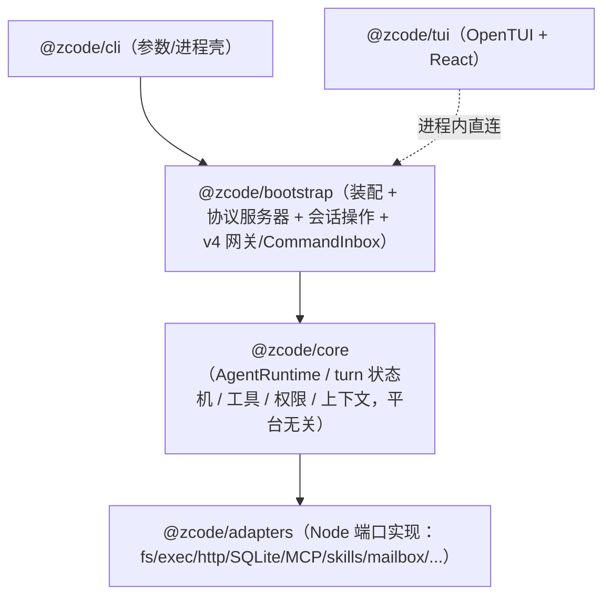
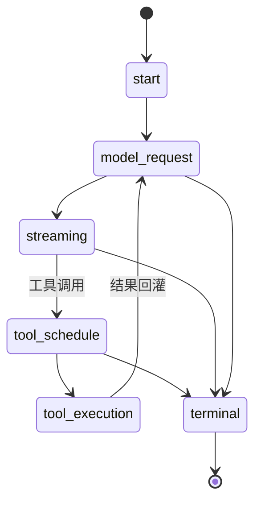

# 04 · Agent CLI 与运行时（apps/zcode-cli）

`apps/zcode-cli` 是独立的 pnpm 子工作区（含 turbo 缓存编排），是所有 AI 能力的执行主体。对外暴露三种宿主形态：**进程内 TUI**、**headless `-p`**、**`app-server --stdio` 子进程**（桌面/Web/远端宿主统一消费第三种）。

## 1. 子包分层（四层洋葱）

| 包                 | 角色                                                                                                                                                                                                                                                                                                  |
| ------------------ | ----------------------------------------------------------------------------------------------------------------------------------------------------------------------------------------------------------------------------------------------------------------------------------------------------- |
| `@zcode/cli`       | bin `zcode` → `dist/zcode.cjs`（esbuild CJS 单文件，target node22）；入口 `src/main.ts`（stdio 边界清洗：protocol 与 TUI 独占 stdout，console 全部进 stderr）→ `run.ts` 分发子命令                                                                                                                    |
| `@zcode/core`      | 运行时内核：AgentRuntime、turn 状态机、工具注册/调度/执行、权限、上下文构建、subagent、compact                                                                                                                                                                                                        |
| `@zcode/bootstrap` | `createZCodeApp` 组装（`app/create-app.ts`）、协议服务器、会话操作（`zcode-protocol/server-operations.ts`）、插件/skills/MCP 装配、v4 网关与 CommandInbox                                                                                                                                             |
| `@zcode/adapters`  | Node 平台适配器：fs/exec/http/storage(SQLite)/mcp/skills/context/mailbox/config/logging/image/pdf/auth                                                                                                                                                                                                |
| `@zcode/contracts` | 端口/事件/领域契约（`browser-control.port`、`events/`、`compact/`、`rewind/` 等）                                                                                                                                                                                                                     |
| `@zcode/tui`       | 终端 UI（React 19 + OpenTUI + shiki + web-tree-sitter），入口 `runTui`                                                                                                                                                                                                                                |
| `@zcode/i18n`      | 文案与 locale（`zh-CN.ts` / `en-US.ts`，含 CLI 帮助文本）                                                                                                                                                                                                                                             |
| 其他               | `shared-types`（RunContext/GlobalOptions 纯类型）、`telemetry`（OTel 封装）、`dynamic-workflow(-runtime)`（工作流 DSL/图与运行时）、`browser-use-plugin`（官方内置插件，MCP server 入口）、`node-repl-host`（共享 node_repl MCP host）、`debug`（Hono + Vite 时间线调试工具）、`swift-bridge`（占位） |
| tools/             | `prompt-trajectory`（prompt/模型 IO 轨迹记录回放）、`typescript`（共享 tsconfig）                                                                                                                                                                                                                     |

## 2. 启动分发

- **发行包层**（`bin/zcode.mjs`，源 `scripts/zcode-distribution/runner.mjs`，构建时被 `scripts/build-zcode.mjs` 拷贝）：`--web` → spawn `server/entry-http.js` 并注入 `ZCODE_AGENT_SERVER_ARGS_JSON` / `ZCODE_WEB_STATIC_ROOT` / `ZCODE_SERVER_AUTH_TOKEN`；否则把 `process.argv[1]` 指向 `agent/zcode.cjs` 动态 import。
- **Agent CLI 层**（`packages/cli/src/run.ts`）：`positionals[0] ?? "tui"`——无参数默认 TUI；`-p/--prompt`、`--target` 走 headless `runPrompt`；`app-server` / `agent-server` → `runZCodeProtocolCommand`；另有 `doctor`、`login/logout`、`plugin(s)`、`skills`、`commands` 等；插件宿主与 DWF 子进程有专用快速路径（`plugin-host-command.ts`、`dwf-child-command.ts`）。

## 3. AgentRuntime 内核（packages/core/src）

- **AgentRuntime**（`runtime/agent-runtime.ts`）：会话内唯一运行时，组合 `PermissionService/PermissionBroker/ToolScheduler/EventReducer/MessageHistory`；40+ 方法经 `runtime/methods/`（sendPrompt、compact、goal、background、rewind、dynamic-workflow-run-\* 等）混入。
- **命令队列**（`runtime/command-queue.ts`）：`RuntimeCommandPriority`（now/next/later）+ `PromptRuntimeCommand` 等，序列化进入 turn。
- **Turn 状态机**（`agent/turn-machine.ts` + `turn-state.ts`）：

- **工具体系**（`tool/`）：`registry.ts`（注册/注销）→ `scheduler.ts`（默认并发 10，按 readOnly/destructive/concurrentSafe 分并行组）→ `executor/impl.ts`；`handlers/` 80+ 文件（bash 含只读判定策略族 `bash-readonly-policy-*.ts` 与后台任务、agent、ask-user-question、node-repl、amend-workflow 等）；`handlers/generated/bash-command-registry.ts` 由 `apps/zcode-cli/scripts/generate-bash-command-registry.mjs` 生成。
- **权限**（`permission/`）：`service.ts`（`PermissionService.check`，规则匹配 `rule-matching.ts`、plan 模式策略）+ `broker.ts`（`DenyPermissionBroker` / `ManualPermissionBroker` 异步客户端授权，对应协议 `permission.requested/resolved` 事件）。
- **上下文**（`context/builder.ts` + `sections/`）：系统提示分节组装（identity/env/skills/memory/date/desktop 等）+ token 估算；compact / microcompact 在 `compact/` 与 `runtime/methods/compact*.ts`。
- **后台任务**：`runtime-task/registry.ts`（`InMemoryRuntimeTaskRegistry`）、`notification-policy.ts`。
- **Subagent**（`subagent/`）：`runner.ts` 前台/后台生命周期、`explore.ts` / `general-purpose.ts`、`profile.ts`、`persistent-memory.ts`。
- **会话存储**：`@zcode/adapters` 的 SQLite `SqliteSessionStore`（会话事实的持久层）。

## 4. app-server 协议形态

- 入口：`bootstrap/src/zcode-protocol-entrypoint.ts` 的 `runZCodeProtocolAgent`——打开 SQLite 会话库 → 起 Provider Registry worker → 组装 `ZCodeProtocolAgentServer` + `ZCodeProtocolNdjsonConnection`（stdin/stdout）。
- 协议细节见 [03-protocols.md](03-protocols.md)。v4 命令经 `v4-gateway.ts` → `CommandInbox`（串行 admission、幂等、guard CAS）→ `host.executeCommand` → `settle()` 回填。

## 5. TUI

- 技术栈：`@mbears/opentui-core/react` + React 19 + shiki + web-tree-sitter；独立 ESM bundle（`packages/tui/scripts/build.mjs`）。
- 入口链：`packages/cli/src/tui-command.ts` → `tui-runtime-loader.ts`（SEA 态从 `node:sea` 资产解包再 import）→ `packages/tui/src/tui.tsx` 的 `runTui`（TTY 校验 → `createCliRenderer` → React root）。
- 结构：86 个 `app-*.tsx/ts` 功能模块（输入面板、transcript、侧栏、模型/模式/effort 面板、subagent 视图、workflow 卡片、权限审批面板等）；与 CLI 的接缝是注入回调接口 `TuiSubmitPrompt` / `TuiRequestPermission` / `TuiSubscribeSessionEvents`（`packages/tui/src/types.ts`）。会话事件中继：`packages/cli/src/tui-session-event-relay.ts`。

## 6. 构建

- **普通 build**（`packages/cli/scripts/build.mjs`）：esbuild 单文件 CJS `dist/zcode.cjs`，target node22（兼容桌面 Electron Node 24 与远端 Node 22）；external：`@zcode/tui`（Ink7/yoga 的 top-level await 需原生动态 import）、`playwright-core`、`koffi`；Zod v4 去重插件 `createZodDedupePlugin`；内置 Provider 配置注入（`scripts/builtin-provider-config.mjs`）。
- **SEA**（`build-sea.mjs`）：资产收集（TUI 运行时、官方插件、bundled skills、工具、Playwright）→ `node --experimental-sea-config` 生成 blob（`useCodeCache:false`、`useSnapshot:false`）→ 平台 Node 二进制 + `postject` 注入（macOS ad-hoc 签名 / Windows Authenticode）。
- **发行包**：根 `scripts/build-zcode.mjs`（`pnpm build:zcode`）组装 `dist/zcode/`（server entry + web 静态根 + agent zcode.cjs + bin/zcode.mjs）。详见 [12-build-and-release.md](12-build-and-release.md)。
