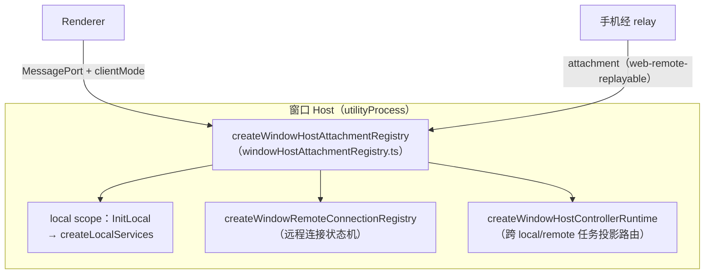

# 05 · 桌面应用（packages/desktop）

`@zcode/desktop`（Electron 41），四个构建目标对应四类进程：`out/main`（Main）、`out/host`（Host utilityProcess）、`out/scheduler`（cron 调度）、`out/preload/*.cjs` + `out/renderer`（vite）。

```text
packages/desktop/src/
├── main/        # Electron Main：入口 index.ts（~2400 行编排）+ 窗口/托盘/更新/遥测/browser-use/Host 进程管理
├── host/        # 窗口 Host 进程：入口 index.ts（~2970 行）+ 本地服务装配 + 远程连接 + attachment 注册
├── scheduler/   # 常驻 cron/off-peak 调度进程（index.ts + schedulerProtocol.ts）
├── preload/     # contextBridge：index.ts 主桥 + browserVideoRecorder / cuaPermissionPanel / oauthCallbackBridge
├── renderer/    # 极薄渲染入口（main.tsx + desktopPlatform 等）；UI 主体在 @zcode/ui
└── shared/      # armsRumShared（ARMS 遥测桥共享 JS）
```

## 1. Main 进程（职责清单）

入口 `src/main/index.ts`。**Main 不承载 task/session 业务状态**，只做：

- **窗口生命周期**：`desktopWindowLifecycle.ts` 的 `createWindow`（dom-ready 后拉起 Host）；renderer reload 时对存活 Host 重挂 MessagePort 而非重启；`primaryWindowCoordinator.ts`（首窗保证）、`desktopDarwinCloseBehavior.ts`（mac 关窗语义）、`desktopTray.ts`（Windows 托盘）。
- **原生操作**：通知、打印 PDF、保存文件、`openInEditor`、Finder/资源管理器集成、深链（OAuth）、`powerSaveBlocker` keep-awake。
- **进程调度**：`desktopHostProcess.ts`（`spawnHostProcess`/`disposeHostProcess[AndWait]`）、`desktopCronScheduler.ts`、app 退出屏障 `prepareAppQuit`（并行回收 telemetry/cron/remote sessions/每窗口 Host）。
- **消息转发/总线**：`broadcastHub.ts`（跨窗口广播）、`taskRealtimeBus.ts`（实时总线，见 §4）、`hostLogRelay.ts`、`desktopRemoteSessions.ts`（远程会话薄转发）。
- **browser-use**：`browserView/` 约 30 文件，`BrowserGuestManager` 以 WebContentsView + CDP 执行 Host 下发的 browser 命令（`runBrowserCommandOnView`）。
- 其他：自动更新 `autoUpdater.ts` + `forceUpdateGuard.ts`、ARMS 遥测与资源采样。

## 2. Host 进程（核心架构）

每个主窗口一个 Host（`utilityProcess.fork(out/host/index.js)`），Main 侧 `windowHostProcessMap: Map<webContentsId, UtilityProcess>`。Host 内两个 scope：



- **attachment 注册表**：`attach({attachmentId, clientMode, scope, port})` → `resolveScope`（local 取 `activeServices`；remote 取 session 的 scoped services + generation）→ 在 MessagePortMain 上建 `ChannelServer` 暴露服务。同 attachmentId 重挂先 dispose 旧者；`detachStaleRemoteSessionAttachments` 处理 session 换代。
- **服务暴露**：`exposeServicesOnMessagePort`（host/index.ts）——`wrapElectronPort` → `MessagePortProtocol` → `ChannelServer`（+ Logging/NetworkTelemetry 装饰器），并按 attachment 注入 overrides（WindowController、MediaPreview Range 代理、Controller-routed TaskService、Agent connectionScope 等）。
- **远程连接注册表**：状态机 connecting/online/closing/failed/disconnected；连接键 `buildConnectionKey`——SSH 按 host key、WSL 按 distro+user **复用同一条物理连接**（多 logical session 共享 ConnectionEntry）；Docker dedicated 不复用；含 WSL idle 回收与 workspace generation barrier。
- **本地多 workspace 共享**：一个窗口内多个本地 workspace 共享该 Host 的 local services（agent 预热最多 3 个，`agentWarmupTargets`）。
- **关闭时序**：`hostShutdownPhases.ts` 分阶段有界回收（remote-registry 6s / services 3.5s）；Main 侧 `disposeHostProcessAndWait` 至少等 3.5s 再强杀，防 agent 孤儿进程。

## 3. Agent 进程生命周期

管理器在 `packages/services/src/zcode-agent/zcodeAgentProcessManager.ts`（由 Host 内 `ZCodeAgentService` 驱动，见 [08-services-layer.md](08-services-layer.md)）：

- **启动命令解析**：开发态 `apps/zcode-cli/packages/cli/dist/zcode.cjs` → 打包态用 app 自带 Electron 以 `ELECTRON_RUN_AS_NODE=1` 执行 `resources/glm/zcode.cjs`（复用 Electron Node，体积 ~180MB→~16MB）→ 远端已部署二进制兜底。参数 `ZCODE_AGENT_RUNTIME.spawnArgs = ["app-server", "--stdio"]`。
- **池化**：同 workspace 复用进程（`restartGenerationByWorkspaceKey` 防竞态）；启动中 promise 收敛；lane 泳道隔离 chat/mcp-status/plugin 多实例；`idleTimeoutMs` 空闲回收（仅控制面 lane）。
- **上报**：`processLifecycleReporter`（spawned/ready/exited/error/exception）→ Host parentPort → Main `HostResponseTypes.AgentProcess*` → ARMS 稳定性遥测。
- Agent 无 TCP 端口（纯 stdio）；唯一固定端口是 dev 态 Main 的 `remote-debugging-port=9229`。

## 4. 实时链路（desktop-continuous）

- **Host 端桥**：`src/host/taskRealtimeBridge.ts`——InitLocal 带 `hostId`/`deliveryKind` 时创建 `SessionRealtimePort`，承担 task run lease（`acquireTaskRunLease`/`releaseTaskRunLease`）与流镜像（`publishStreamOp`：user_message/stream_event）。
- **Main 端总线**：`src/main/taskRealtimeBus.ts` `TaskRealtimeBus`——多 Host 注册（deliveryKind `desktop_window | relay_bridge`，类型在 `packages/shared/src/task-realtime.ts`）；lease 仲裁；流镜像批处理（1s flush、512KB 批上限、60 批回放上限）；owner 命令路由（30s 超时）；经 `HostMessageTypes.TaskRealtimeDeliver` 下发。
- 远程 workspace 无远端 realtime port 时，由窗口 Host 内 remote facade 接管 lease 与 mirror。

## 5. 远程工作区接入

- Main 侧 `desktopRemoteSessions.ts` 只做**薄转发**（requestId/sessionId → 端口转发关联）；实际连接由窗口 Host 执行（`setupRemoteConnection` 动态 `import("@zcode/server/remote")`，避免 ssh2 CJS 链在 asar 内破坏 local 模式）。
- 资产来源：生产走 CDN（`__ZCODE_CDN_BASE_URL__`，默认 `https://cdn-zcode.z.ai/zcode/electron/releases/<version>`）+ 本地缓存；开发态读仓库 `packages/desktop/mock-cdn`。详见 [10-remote-workspace.md](10-remote-workspace.md)。

## 6. 构建与打包要点

- **tsup 四目标**（`tsup.config.ts`）：main/host/scheduler 为 ESM(node22)，preload 为 CJS；`external` 保留 electron/node-pty/ssh2/undici/node-forge/yauzl 等（避免 Electron ESM dynamic require 崩溃），`noExternal` 内联全部 `@zcode/*`；`define` 注入 `__ZCODE_VERSION__`/`__ZCODE_ENV__`/`__ZCODE_CDN_BASE_URL__`。
- **renderer**：vite（`vite.config.ts`）。
- **runtime assets**（`scripts/prepare-runtime-assets.mjs`）：编排远端原生二进制（mock-cdn/缓存）、agent bundle（`prepare-agent-node-bundle.mjs`）、ripgrep 等原生搜索工具、macOS window-bounds / Windows browser-import-helper。
- **Agent bytecode**（根 `scripts/build-desktop-agent-bytecode.mjs`）：生成 `zcode.bytecode.cjs` loader + `zcode.bytecode-<sha256>.jsc`（不可变发布、sha256 校验）；运行时以 `--no-lazy --no-flush-bytecode` 加载。
- **electron-builder**（`electron-builder.config.js`）：extraResources 携带 `glm`（agent bundle）、`tools/ripgrep`、图标、`config/default.json`、内置 Provider 配置；asar 后做机械校验（必需 runtime 模块闭包、原生包策略、sourcemap 清理、Windows NSIS 补丁、app.asar 重打包）。
- 详见 [12-build-and-release.md](12-build-and-release.md)。
