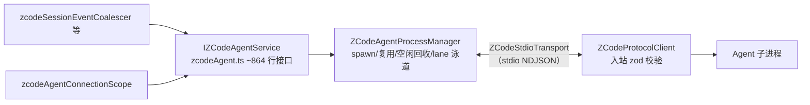

# 08 · 服务层（packages/services）与服务访问 SDK（packages/client）

## 1. 服务化三件套（核心机制）

| 机制                   | 文件                 | 作用                                                                                                                                     |
| ---------------------- | -------------------- | ---------------------------------------------------------------------------------------------------------------------------------------- |
| `ServiceDescriptor<T>` | `src/descriptors.ts` | `channelName + phantom type`；`createServiceDescriptor<T>()` 利用 TS "同名 interface + const" 让 `IFileService` 既是类型又是运行时描述符 |
| `ServiceCollection`    | `src/collection.ts`  | `register/get/getOptional` + `exposeOnChannelServer(server, overrides)`——把全部注册服务经 `ProxyChannel.fromService` 自动挂成 channel    |
| `IServiceAccessor`     | `src/accessor.ts`    | 聚合所有服务类型的浏览器安全类型面                                                                                                       |

效果：**写一个普通 class + descriptor，就自动获得 RPC 服务能力**。宿主（desktop Host、server、server-cli core）创建实例并 expose；前端经 `@zcode/client` 还原。

入口：`.`（browser-safe 根入口）、`./node`（Node 实现）、`./cua-permission-broker`、`./process/processTreeTerminator`、`./storage-startup`。

## 2. 服务清单

| 模块                        | 服务 / 职责                                                                                                                                                                                                                                                                                                                                                                                                                        |
| --------------------------- | ---------------------------------------------------------------------------------------------------------------------------------------------------------------------------------------------------------------------------------------------------------------------------------------------------------------------------------------------------------------------------------------------------------------------------------- |
| `file/` + `fs/`             | `IFileService` 文件读写/目录枚举（channel "file"）                                                                                                                                                                                                                                                                                                                                                                                 |
| `media-preview/`            | `IMediaPreviewService` 大媒体预览准备                                                                                                                                                                                                                                                                                                                                                                                              |
| `fileWatcher/`              | `IFileWatcherService` 文件系统监视                                                                                                                                                                                                                                                                                                                                                                                                 |
| `git/`                      | `IGitService` + `IGitCheckpointService`（checkpoint 快照）                                                                                                                                                                                                                                                                                                                                                                         |
| `terminal/`                 | `ITerminalService`（node-pty）                                                                                                                                                                                                                                                                                                                                                                                                     |
| `system/`                   | `ISystemService` 系统信息                                                                                                                                                                                                                                                                                                                                                                                                          |
| `setting/`                  | `ISettingService` 应用设置读写                                                                                                                                                                                                                                                                                                                                                                                                     |
| `credential/`               | `ICredentialService` 凭据安全存储                                                                                                                                                                                                                                                                                                                                                                                                  |
| `broadcast/`                | `IBroadcastService` 跨窗口广播 + claim 租约                                                                                                                                                                                                                                                                                                                                                                                        |
| **`zcode-agent/`**          | **心脏**：`IZCodeAgentService`（27 文件，见 §3）                                                                                                                                                                                                                                                                                                                                                                                   |
| `zcode-session/`            | `IZCodeSessionService` API 重试、导入 Claude 会话修复                                                                                                                                                                                                                                                                                                                                                                              |
| `session/`                  | `IZCodeTaskService` 任务列表/归档/置顶、automation 定时任务、Off-Peak 运行时、tasksDatabase                                                                                                                                                                                                                                                                                                                                        |
| `bots/`                     | `IBotsService` IM/Lark 机器人接入与远程 workspace 绑定                                                                                                                                                                                                                                                                                                                                                                             |
| `conversation-share/`       | `IConversationShareService` 会话分享发布/导入                                                                                                                                                                                                                                                                                                                                                                                      |
| `conversation-telemetry/`   | 会话遥测                                                                                                                                                                                                                                                                                                                                                                                                                           |
| `model-provider/`           | `IProviderSettingsService`、`IModelSelectionService`、Provisioning target、账号认证                                                                                                                                                                                                                                                                                                                                                |
| `oauth/`                    | `IOAuthService`                                                                                                                                                                                                                                                                                                                                                                                                                    |
| `plugins/` + `plugin-sync/` | 插件市场/安装/配置 + SSH 远端同步（术语见 CONTEXT.md）                                                                                                                                                                                                                                                                                                                                                                             |
| `skills/` + `skill-sync/`   | Skills 管理 + 远端同步                                                                                                                                                                                                                                                                                                                                                                                                             |
| `subagents/`                | `ISubagentsService`                                                                                                                                                                                                                                                                                                                                                                                                                |
| 其他                        | `commands/`（命令与快捷键）、`hooks/`（workspace hooks）、`memory/`、`feedback/`、`onboarding/`、`usage-stats/`、`coding-plan-subscription/`、`client-config/`、`client-scenes/`、`mcp-sync/`、`settings-sync/`、`device/`、`bigmodel/`、`prompt-attachment-transfer/`、`window-controller/`（窗口聚合投影）、`cua-permission-broker/`、`storage/`、`process/`（进程树终止与采样）、`telemetry/`、`runtime-tools/`、`remote-sync/` |

channel 名单一来源：`packages/shared/src/channels.ts` 的 `ServiceChannels`（约 45 个）。

## 3. zcode-agent：Agent 集成核心（src/zcode-agent/）

- **接口面**（`zcodeAgent.ts`）：`prepareStorage/initialize/createSession/resumeSession/listSessions/readSession*/sendPrompt/setModel/setMode/setThoughtLevel/compactSession/goalSession/closeSession`、插件/工作流/automation 管理、MCP 状态、`onDynamic*` 事件族（含进程资源采样、MCP 遥测）。
- **进程管理**（`zcodeAgentProcessManager.ts`）：按 workspaceKey 池化复用；`restartGenerationByWorkspaceKey` 防重启竞态；同 workspace 启动中 promise 收敛；lane 泳道隔离 chat/mcp-status/plugin；`resolveSpawnEnv` 注入设置页代理与 CUA 凭据；Agent 二进制定位链（env → Electron resourcesPath → `~/.zcode/server/agents/` → 仓库 `bundled-agents`，见 `runtime-tools/providerRuntimeResolver.ts`）。
- **连接隔离**：`zcodeAgentConnectionScope.ts` 为每个前端连接建立隔离的 Agent 服务视图（Web 多连接、scoped remote session 场景）。

## 4. 日志体系（src/logger/serviceLogger.ts）

- `ServiceLogger = {debug|info|warn|error}`，每个方法首参 `traceId: TraceId | undefined`，前缀 `[scope][trace:<id>] + pid`。
- `createServiceLogger(scope, {pid?, sink?, isDebugEnabled?})`：debug 默认仅开发 Node 环境打印；sink 可替换。
- 设计动机（文件内注释）：把通用分级日志从 Agent 命名 logger 中拆出，避免删除 Agent runtime 时牵连其他服务；traceId 一等公民服务于跨进程链路追踪。
- 分级纪律（AGENTS.md）：debug=高频诊断（生产不落盘）、info=生命周期与权限结果、warn=可恢复、error=不可恢复。禁止写入凭据/真实用户数据/内部服务地址。

## 5. packages/client（消费侧 SDK）

仅 6 个源文件，三条传输入口殊途同归到 `RemoteServiceAccess`（实现 `IServiceAccessor`，为约 45 个服务 descriptor 逐一 `ProxyChannel.toService` 生成类型安全远程代理；`providerProvisioningTargetService` 用不可枚举属性避免向 renderer 暴露 Secret 写入口）：

| 入口                                                                       | 文件                 | 场景                                                                                                                                                  |
| -------------------------------------------------------------------------- | -------------------- | ----------------------------------------------------------------------------------------------------------------------------------------------------- |
| `connectViaWebSocket(wsUrl)`                                               | `src/websocket.ts`   | 浏览器（web 主应用 / 手机远控）                                                                                                                       |
| `connectViaMessagePort(port)` / `createMessagePortServiceConnection(port)` | `src/messageport.ts` | Electron renderer ↔ Host；后者返回 `{services, dispose(reason)}`——scoped remote session 换代时必须释放 ChannelClient + port，否则挂起 RPC 无法 settle |
| `connectViaProtocol(protocol)`                                             | `src/websocket.ts`   | 任意已有 `IMessagePassingProtocol`                                                                                                                    |

引用方：`packages/desktop/src/renderer/src/main.tsx`、`packages/web/src/main.tsx`、`packages/server/src/remote/connect.ts`（SSH 远程链：远端 stdio → ISocket → SocketProtocol → ChannelClient → RemoteServiceAccess，把远端服务桥回宿主）。
