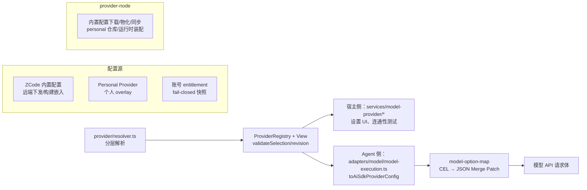

# 09 · 模型 Provider 体系（provider / provider-node / model-option-map）

三个包构成「配置内核 → Node 落地 → 请求改写」的模型接入链。**同一份 Provider 配置既驱动宿主侧设置 UI/Registry，也驱动 Agent 子进程内的模型执行**。

## 1. packages/provider（平台无关内核）

依赖仅 `@zcode/shared`、`@zcode/model-option-map`、zod。要点：

- `src/registry.ts`：`ProviderRegistry` + `ProviderRegistryView`——`listProviders/getProvider/getModel/validateSelection/replace`，带 revision 与变更事件；`ModelSelectionValidation` 校验 provider/model/reasoning level 存在性。
- `src/resolver.ts`：分层解析（ZCode 内置 → 个人 overlay → 账号 entitlement）产出 `RegistryProviderConfig/RegistryModelConfig`（complete 类型）。
- `src/config/`：`ProviderConfig`、`ModelConfig`、`ProviderTemplateMap`、`ApiKeyAccessConfig`、`ZhipuAccountAccessConfig` 等。
- `src/facades.ts`：`ProviderSettingsFacade`/Selection Facade（个人 provider/model 增删改排序、模板创建）。

**接入形态**：不内置厂商清单，而是「内置配置 + Personal + Template」。访问方式两类：`access.type = "api-key"`（apiKey + 管理链接）与 `"zhipu-account"`（账号 entitlement）。**API 协议类型**三选一：`anthropic-messages` / `openai-responses` / `openai-chat-completions`。

## 2. packages/provider-node（Node 落地）

- 内置配置源：`zcode-builtin-provider-config-source.ts`、`zcode-builtin-download.ts`、`zcode-builtin-remote-synchronizer.ts`、物化器与缓存路径管理（`ZCODE_BUILTIN_PROVIDER_CONFIG_FILE` 可指向本地文件覆盖）。
- 个人配置仓库：`personal-provider-config-repository.ts`、`model-selection-config-repository.ts`。
- 运行时装配：`provider-registry-runtime.ts`（`ProviderRegistryRuntime`）、`provider-config-runtime.ts`、legacy reasoning level 迁移。
- 消费方：宿主侧 `packages/services/src/model-provider/`（设置 UI/Registry/Provisioning/连通性测试）与 Agent 侧 `apps/zcode-cli/packages/{adapters,bootstrap,cli}`。

## 3. Agent 侧模型执行（apps/zcode-cli/packages/adapters/src/model/model-execution.ts）

`toAiSdkProviderConfig` 把 `RegistryProviderConfig` 映射为 AI SDK provider：

| 协议类型                  | AI SDK 工厂                                                                    |
| ------------------------- | ------------------------------------------------------------------------------ |
| `anthropic-messages`      | `createAnthropic`                                                              |
| `openai-responses`        | `createOpenAI().responses`                                                     |
| `openai-chat-completions` | `createOpenAICompatible`（includeUsage、supportsStructuredOutputs 按模型事实） |

上层补丁：`patches/@ai-sdk__openai-compatible@2.0.60.patch`、`patches/@ai-sdk__anthropic@3.0.81.patch`。

## 4. packages/model-option-map（受限 CEL 解释器）

极小的 CEL 子集（tokenizer/parser/compiler/evaluator，零运行时依赖），把 `reasoningLevel` / `maxOutputTokens` 两个模型选项的取值映射为 **JSON Merge Patch** 应用到请求体——例如把 "high" 翻译成 Anthropic 的 `thinking.budget_tokens` 或 OpenAI 的 `reasoning.effort`，Provider 配置只需声明 map 表达式，无需为每家厂商硬编码。

- 关键接口：`compileModelOptionMaps(specs)` → `CompiledModelOptionMaps.apply(body, values)`；`RestrictedCelProgram.evaluate(input)`。
- **冲突安全**（`src/merge-patch.ts`）：`applyOrderedJsonMergePatches` 追踪每个 option 写过的 JSON path，两个 option 写重叠路径即抛错。
- 三处消费：`packages/provider`（表达式编译校验）、`packages/shared/src/model-config.ts`（schema 层就编译验证表达式合法性）、Agent 执行侧 `model-execution.ts` + `model-option-map-fetch.ts`（`createModelOptionMapFetch` 包装 fetch 改写请求体）。
