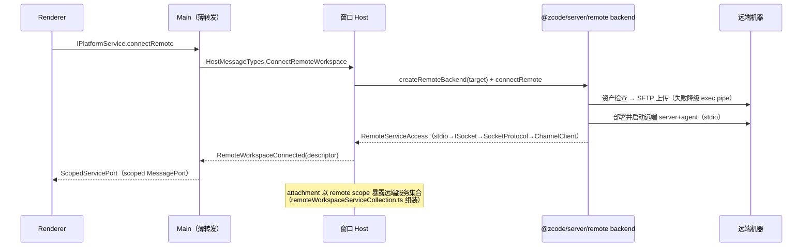
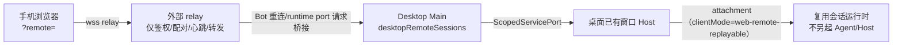

# 10 · 远程工作区与手机远控

远程能力让桌面 App 操作远端机器（SSH/WSL/Docker）上的代码，并让手机浏览器远控桌面上的会话。**边界规则**（AGENTS.md）：外部 relay 与 Main 只做鉴权、配对、心跳、转发及 attachment 调度，不保存任务队列、快照等业务状态；手机远控复用桌面已有 Host attachment，不为手机另起 Agent、Local Host 或远程会话。

## 1. Workspace Identity（身份键）

统一构造/解析工具：`packages/shared/src/remote-workspace-identity.ts`（**禁止业务代码手写拼接**）。

| 格式                                          | 说明   |
| --------------------------------------------- | ------ |
| `remote:ssh:<host>:<port>:<user>:<posixPath>` | SSH    |
| `remote:wsl:<distro>[:<user>]:<path>`         | WSL    |
| `remote:docker:<container>:<path>`            | Docker |

- `workspaceIdentity` 用于**身份隔离**（去重、绑定、缓存、队列、持久化、请求关联）；`workspacePath` 用于文件操作、命令 cwd、Git、路径展示。
- 身份 key 统一为 `workspaceIdentity?.trim() || workspacePath`；新接口保留本地路径 fallback。
- 远程链路贯穿传递 `workspaceIdentity` 与 `remoteSessionId`，不得仅按路径匹配。`remoteSessionId` 定位某条远程连接 scope（出现在 `platform.ts`、`task-realtime-core.ts`、`zcode-protocol-v4/controller.ts` 等约 11 个文件；v4 命令校验：remoteSessionId 必须伴随 workspaceIdentity）。

## 2. 连接链路（桌面形态）

- **backend 实现**：`packages/server/src/remote/`——`ssh-backend.ts`（ssh2）、`wsl-backend.ts`、`docker-backend.ts`、`connect.ts`（桥接）、`deploy.ts`/`deployShared.ts`（资产部署决策）、`zcodeAgentDeploy.ts`（远端 Agent 部署）、`zcodeAgentBundleWrapper.ts`。
- **连接复用**：Host 侧 `windowRemoteConnectionRegistry.ts` 的 `buildConnectionKey`——SSH 按 host key、WSL 按 distro+user **复用同一物理连接**（多 logical session 共享 ConnectionEntry）；Docker dedicated 不复用；WSL 有 idle 回收（`scheduleWslIdleDispose`）与 workspace generation barrier。
- **Host 动态加载**：`setupRemoteConnection` 动态 `import("@zcode/server/remote")`，避免 ssh2 CJS 链在 asar 内破坏 local 模式。
- **附件/媒体**：`remotePromptAttachments.ts` 物化附件；`remoteMediaPreviewProxy.ts` 做媒体 Range 预览代理。
- **任务路由**：`createWindowHostControllerRuntime` 的 `resolveSource` 决定任务投影/变更（pin/archive/delete/unread）走 local 还是 remote taskService。

## 3. 资产部署（远端运行时从哪来）

- **生产**：CDN（`remoteCdn.ts`，默认 `https://cdn-zcode.z.ai/zcode/electron/releases/<version>`，构建期注入 `__ZCODE_CDN_BASE_URL__`）+ 本地 `remoteCacheDir`。
- **开发**：仓库 `packages/desktop/mock-cdn`（`mock-cdn/releases/<version>` 存在才启用）；由根脚本 `scripts/prepare-prebuilds.mjs`（`pnpm prepare:remote-assets`）填充。开发态「本地下载后上传」，不访问 CDN。
- **安装器**：`remoteAssetInstaller.ts` 按平台 arch 校验完整性（`LocalUploadAssetInstaller` 等）。
- 远端 Agent 命中已部署原生二进制时可复用；否则上传 bundle。

## 4. Web 形态的远程

`packages/server`：`POST /api/connect-remote` 建立连接（内存 `remoteConnections` Map 返回随机 id）→ `GET /ws/remote/:id` 把远端 file/git/system/terminal 服务桥接给浏览器。`packages/web` 的 `allowRemoteWorkspace=false`（Web 客户端自身不发起桌面式远程连接，普通 Web 模式下 `connectRemote` 报 not supported）。

## 5. 手机远控（web-remote-replayable）

- 入口：Web 页面带 `?remote=<id>` → `/ws/remote/<remoteId>`（`packages/web/src/main.tsx`）。
- 桌面 Main `desktopRemoteSessions.ts` 负责 Bot 重连、远程 workspace 状态、runtime port 请求的桥接（薄转发，无业务状态）。
- **回放语义**：手机走 `web-remote-replayable`（deliveryProfile 150ms 档、可 snapshot resync 恢复），与桌面 `desktop-continuous`（30ms 档常连）明确区分；两种语义在 stream/snapshot/queue/重连改动时必须同时验证。
- UI 侧配套：`remoteWorkspaceSessionStore`（会话注册表）、`remotePinnedTaskStore` / `remoteTimelineTaskStore`、设备指纹 `generateMobileDeviceFingerprint()` 作为稳定 stream clientId、远控语言以桌面 setting.json 为准。

## 6. Bot 接入（IM/Lark）

- `packages/services/src/bots/`：`IBotsService` 管理 IM 机器人与远程 workspace 绑定。
- Webhook：`packages/server/src/http.ts` 的 `POST /api/bots/:provider(/:botId)`（仅 webhook provider，校验 `x-zcode-bot-secret`）。
- Bot 消息最终也进入桌面已有 Host attachment 复用会话运行时（`onBotRemoteWorkspaceReconnected` 等事件见 `platform.ts`）。
