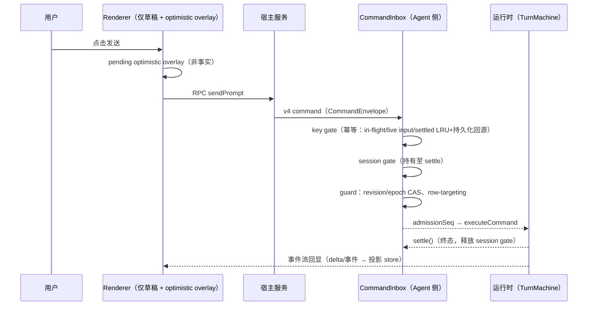
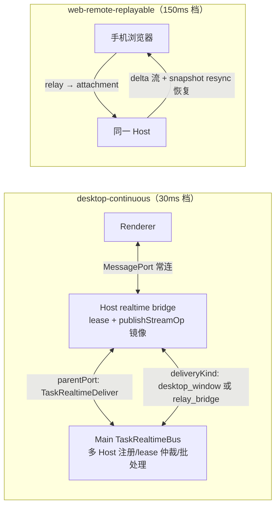

# 11 · 状态管理与数据流

本文回答「每一类状态的所有者是谁、事件顺序如何、哪里允许写」。总原则（AGENTS.md）：避免重复状态和多条写入路径；明确唯一所有者与幂等边界，不能用超时掩盖同步问题。

## 1. 状态所有权总表

| 状态                                       | 唯一所有者（事实源）                                                                   | 其他持有者（投影/缓存）                                                           |
| ------------------------------------------ | -------------------------------------------------------------------------------------- | --------------------------------------------------------------------------------- |
| 会话与消息历史、turn 事实、命令 settlement | **Agent 进程**（SQLite `SqliteSessionStore` + 持久化命令索引）                         | 宿主 `IZCodeAgentService` 事件聚合/投影；前端 conversation 投影 store             |
| 应用设置                                   | settingService（Host 服务，落盘）                                                      | `useSettingService` hook 读取；设置变更经 `PlatformChannels.SettingsChanged` 推送 |
| 任务列表/归档/置顶                         | taskService（Host/远端）+ `zcodeTaskIndexSyncer` 同步                                  | 前端 `taskQueryCacheStore`（查询缓存 + membership + unread 乐观 overlay）         |
| 已接受输入的 admission 顺序                | **CLI/runtime `CommandInbox`**（串行 admission、幂等、guard CAS）                      | Renderer 仅未提交草稿 + pending optimistic overlay                                |
| 任务运行权（lease）                        | Host 端 realtime bridge / TaskRealtimeBus 仲裁（`acquireTaskRunLease`）                | owner 命令经 30s 超时路由                                                         |
| 跨 Host 路由                               | owner/lease + stale run 防护                                                           | 不得仅按单一路径删除边界判断                                                      |
| UI 偏好（theme/locale/字号/interfaceMode） | 各窗口 store + 广播同步（`BROADCAST_FIELDS`）                                          | localStorage/DOM 副作用随 setter 连带执行                                         |
| 会话 UI 状态（草稿、面板开合等）           | 前端 `zcodeSessionStore`（按 workspace 分桶，不广播）                                  | E2E bridge / 内存诊断注册表                                                       |
| 远程连接状态机                             | Host `windowRemoteConnectionRegistry`（connecting/online/closing/failed/disconnected） | Main 仅 requestId→端口关联（薄转发）                                              |
| workspace 身份                             | `workspaceIdentity`（构造/解析统一走 shared 工具）                                     | `remoteWorkspaceSessionStore` 双索引（sessionId / identity）                      |

## 2. 输入 admission 时序（谁在什么时候排队）

要点：busy/running 期间到达的输入**不丢弃**——由 CommandInbox 依据队列语义 admission（now/next/later 优先级在 Agent `command-queue.ts`）；前端不做事实判断，重连后以回放/快照对齐。

## 3. 实时双链路（desktop-continuous vs web-remote-replayable）

- 投递档位与匹配校验：`packages/shared/src/zcode-protocol-v4/core.ts`（DeliveryProfile）、`transport.ts`（hello 校验 clientMode+deliveryProfile）。
- 流镜像有界：TaskRealtimeBus 批处理 1s flush、512KB 批上限、60 批回放上限；owner 命令路由 30s 超时。
- 远程 workspace 无远端 realtime port 时，由窗口 Host 内 remote facade 接管 lease 与 mirror。
- v4 delta 是**七操作封闭集合**，表达不了就 snapshot resync（防状态发散）。

## 4. UI 投影与回环防护

- 会话回显：v3 事件族（`session/subscribe`）或 v4 delta（`v4/conversation/subscribe`）→ `conversationProjectionStore` / v4 apply → React 渲染；`streamClientId`（设备指纹或桌面 id）用于流式 owner/observer 过滤。
- 跨窗口偏好广播三重防回环（详见 [07-ui-layer.md](07-ui-layer.md) §3.2）：`applyingBroadcast` 标志、结构化 payload + `sourceWindowId` 本地回声忽略、操作序号防过期覆盖。
- UI 局部状态不得误当作服务端事实：乐观 overlay 必须能被事件流纠正（unread overlay、pending 消息等）。

## 5. 时钟与一致性规则

- v4 wire 协议**一律 CLI 时钟**（`zcode-protocol-v4/core.ts`）；seq 单调，事件信封带 `eventId/sessionId/turnId/seq/deliveryKind`。
- 协议边界一律 zod strict + 限长校验，防无界载荷；嵌套二进制在 JSON fallback 中以 base64 标记往返保留。
- 持久化事实（transcript/timeline/child/discarded 四级回源）支撑命令幂等重试；settled 结果 LRU 512 per session。
- scoped remote session 换代时必须释放旧 ChannelClient + port（`createMessagePortServiceConnection` 的 `dispose(reason)`），否则挂起 RPC 无法 settle；同 attachmentId 重挂先 dispose 旧者，`detachStaleRemoteSessionAttachments` 清理换代残留。
